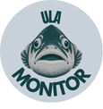
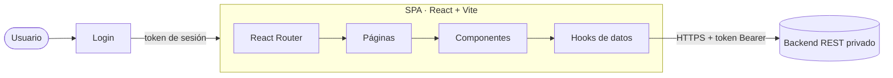

<div align="center">



# ULA Monitor

**Monitoreo en tiempo real del oxígeno disuelto en centros de cultivo acuícola**

[](https://react.dev)
[](https://vite.dev)
[](https://tailwindcss.com)
[](https://reactrouter.com)
[](https://leafletjs.com)
[](https://pnpm.io)
[](LICENSE)

[Características](#-características) ·
[Inicio rápido](#-inicio-rápido) ·
[Configuración](#-configuración) ·
[Arquitectura](#-arquitectura) ·
[Tips](#-tips-y-solución-de-problemas) ·
[Equipo](#-equipo)

</div>

---

## 📌 Sobre el proyecto

En un centro de cultivo, el **oxígeno disuelto** es la variable que más rápido puede convertirse en una emergencia: si cae por debajo del mínimo seguro, los peces se estresan o mueren en cuestión de horas. **ULA Monitor** es un panel web que reúne las lecturas de los sensores instalados en jaulas y pontones, detecta lo que está fuera de rango o dejó de transmitir y lo pone **primero en pantalla**, para que el equipo de operaciones pueda reaccionar y registrar intervenciones sin perder tiempo.

Este es el **frontend** del sistema: una SPA en React que consume un backend REST externo (privado, no incluido en este repositorio).

> Proyecto desarrollado para el curso **Tecnologías Web y Móviles**.

---

## ✨ Características

| Ruta | Vista | Qué permite hacer |
| --- | --- | --- |
| — | **Inicio de sesión** | Acceso con usuario y contraseña. La sesión se mantiene al recargar la página. |
| `/` | **Dashboard** | Ver en vivo el estado de toda la red de sensores y actuar sobre las alertas. |
| `/centros` | **Centros** | Buscar, filtrar y revisar el detalle de cada centro de cultivo. |
| `/intervenciones` | **Intervenciones** | Consultar el historial y registrar nuevas intervenciones. |

### 🔐 Inicio de sesión

- Formulario con validación, botón para **mostrar u ocultar la contraseña** y mensajes de error claros (credenciales incorrectas, servidor caído, etc.).
- Si ya hay una sesión guardada en el navegador, la app entra directo al Dashboard.

### 📊 Dashboard

La pantalla principal está pensada como un **monitor en vivo**: se actualiza sola cada **60 segundos** (indicador `EN VIVO` + "Actualizado hace X") y además tiene un botón **Actualizar**.

- **Estado de la red**: anillo con el porcentaje de sensores operativos y el conteo por estado.
- **Mapa de centros** (Leaflet): cada centro aparece en su ubicación real. El marcador es un anillo que muestra la proporción de sensores en cada estado, al centro indica cuántos tienen problemas y **late** si hay alertas. Al tocar un centro se carga su detalle.
- **Requieren atención**: tabla con los sensores problemáticos, **ordenados por criticidad**, cada uno con un minigráfico de su tendencia en las últimas 24 h. Desde aquí se puede **abrir una intervención en línea**, con un motivo sugerido automáticamente que el usuario puede editar.
- **Últimas intervenciones**: línea de tiempo con las abiertas primero (trabajo pendiente) y luego las cerradas más recientes.
- **Perfil del centro**: cada jaula o pontón se dibuja como una **columna de agua** y sus sensores aparecen a la **profundidad real** donde están instalados, con el color de su estado. Así se ve de un vistazo si el problema está en la superficie o en el fondo.
- **Gráfico de oxígeno**: mediciones de las últimas 24 h del sensor elegido, con la **franja del rango seguro** (mínimo y máximo) y un tooltip con fecha, hora y temperatura.

### 🏭 Centros

- Búsqueda por nombre y filtros: **Todos**, **Con problemas**, **Operativos** e **Inactivos**.
- Tarjetas ordenadas para que los centros con problemas aparezcan arriba, con el conteo de sensores por estado.
- Ventana de detalle con los sensores que requieren atención (incluida su profundidad) y un botón **Solicitar intervención** que lleva al formulario con el centro ya seleccionado.

### 🛠️ Intervenciones

- Historial con filtro por estado (**Todas**, **Abiertas**, **Cerradas**) y paginación de 10 en 10.
- Formulario **Nueva intervención** para registrarla sobre un centro completo o sobre un sensor específico.

### 🚦 Estados de un sensor

| Estado | Color | Significado |
| --- | --- | --- |
| **Fuera de rango** | 🟡 Amarillo | La última lectura de oxígeno está fuera del rango seguro configurado para ese sensor. |
| **Sin transmitir** | 🔴 Rojo | El sensor dejó de enviar datos. |
| **Buen funcionamiento** | 🟢 Verde azulado | Transmite y su lectura está dentro del rango. |

**Orden de criticidad** usado en el Dashboard:

1. Sensores **fuera de rango**, del oxígeno **más bajo** al más alto.
2. Sensores **sin transmitir**, del que lleva **más tiempo** en silencio al más reciente.
3. Sensores en buen funcionamiento.

---

## 🧰 Stack tecnológico

| Tecnología | Versión | Uso en el proyecto |
| --- | --- | --- |
| [React](https://react.dev) | 19 | Librería de interfaz. |
| [Vite](https://vite.dev) | 8 | Servidor de desarrollo y empaquetado para producción. |
| [Tailwind CSS](https://tailwindcss.com) | 4 | Estilos con clases utilitarias (integrado con `@tailwindcss/vite`). |
| [React Router](https://reactrouter.com) | 7 | Navegación entre vistas (`react-router-dom`). |
| [Recharts](https://recharts.org) | 3 | Gráficos: anillo de estado, minigráficos y gráfico histórico. |
| [Leaflet](https://leafletjs.com) + [React Leaflet](https://react-leaflet.js.org) | 1.9 / 5 | Mapa interactivo de centros. |
| [Oxlint](https://oxc.rs/docs/guide/usage/linter) | 1 | Linter rápido con reglas de React. |
| [pnpm](https://pnpm.io) | ≥ 9 | Gestor de paquetes (el proyecto incluye `pnpm-lock.yaml`). |

> [!NOTE]
> `babel-plugin-react-compiler` y `@rolldown/plugin-babel` están instalados como dependencias de desarrollo, pero el React Compiler **todavía no está activado** en `vite.config.js`.

---

## ✅ Requisitos previos

| Herramienta | Versión mínima | Cómo verificar |
| --- | --- | --- |
| [Node.js](https://nodejs.org) | `20.19` o `22.12+` (se recomienda la LTS más reciente) | `node --version` |
| [pnpm](https://pnpm.io/installation) | `9` o superior | `pnpm --version` |
| [Git](https://git-scm.com) | cualquiera reciente | `git --version` |

Además necesitas **acceso al backend**: la URL de la API y un usuario válido. Pídeselos al equipo.

Si no tienes pnpm, instálalo de forma global con npm:

```bash
npm install -g pnpm
```

> Probado con **Node 26** y **pnpm 12** en Windows 11.

---

## 🚀 Inicio rápido

**1. Clonar el repositorio**

```bash
git clone https://github.com/Chuito8888/Proyecto-Tecnologias-Web.git
cd Proyecto-Tecnologias-Web
```

**2. Instalar las dependencias**

```bash
pnpm install
```

**3. Configurar las variables de entorno**

Crea un archivo `.env` en la raíz del proyecto (ver [Configuración](#-configuración)):

```env
VITE_API_URL=https://tu-servidor.ejemplo.com
```

**4. Levantar el servidor de desarrollo**

```bash
pnpm dev
```

Abre **http://localhost:5173** en el navegador e inicia sesión con tus credenciales.

---

## 🔧 Configuración

La app se configura con variables de entorno que Vite lee al arrancar. Solo las que empiezan con `VITE_` quedan disponibles en el navegador.

| Variable | Obligatoria | Descripción | Ejemplo |
| --- | :---: | --- | --- |
| `VITE_API_URL` | ✅ | URL base del backend, **sin** `/` al final. | `https://tu-servidor.ejemplo.com` |

> [!IMPORTANT]
> El archivo `.env` está en `.gitignore` y **nunca debe subirse al repositorio**. Ten en cuenta también que todo lo que empieza con `VITE_` se incrusta en el JavaScript final y cualquiera puede verlo en el navegador: úsalo para URLs públicas, **jamás** para contraseñas, llaves o tokens.

---

## 📜 Scripts disponibles

| Comando | Descripción |
| --- | --- |
| `pnpm dev` | Inicia el servidor de desarrollo con recarga en caliente (HMR) en `http://localhost:5173`. |
| `pnpm build` | Genera la versión optimizada para producción en la carpeta `dist/`. |
| `pnpm preview` | Sirve localmente el contenido de `dist/` para probar el build antes de publicarlo. |
| `pnpm lint` | Revisa el código con Oxlint. |

---

## 🧱 Arquitectura



El código se organiza en capas con responsabilidades claras:

- **`pages/`** define cada ruta y compone la vista.
- **`components/`** contiene piezas de interfaz **sin lógica de red**: reciben datos y callbacks por props.
- **`hooks/`** concentra **todo el acceso a datos**: llamadas al backend, combinación de respuestas, orden por criticidad y estados de carga y error.
- **`utils/`** reúne funciones de formato reutilizables.

**Autenticación.** Al iniciar sesión, el backend entrega un token que se guarda en `localStorage` y se envía en cada petición como `Authorization: Bearer <token>`. Si el servidor rechaza el token, el Dashboard muestra el aviso "Tu sesión expiró". **Cerrar sesión** borra el token del navegador.

**Dashboard sin endpoint propio.** No existe un servicio que entregue el Dashboard armado: el hook `useDashboard` hace varias consultas en paralelo, cruza los resultados y calcula los conteos, el orden de criticidad y las tendencias directamente en el frontend. Si falla una parte secundaria (por ejemplo, los minigráficos), el resto del panel sigue funcionando.

**Localización.** Toda la interfaz está en español de Chile: el oxígeno se muestra con coma decimal (`6,8 mg/L`), las fechas relativas como "hace 3 h" y los horarios en la zona `America/Santiago`.

---

## 📁 Estructura del proyecto

```text
Proyecto-Tecnologias-Web/
├── public/                     # Archivos estáticos servidos tal cual
├── src/
│   ├── assets/                 # Logo e imágenes
│   ├── components/             # Componentes de interfaz
│   │   ├── Login.jsx           # Pantalla de inicio de sesión
│   │   ├── NavegationBar.jsx   # Menú lateral y cierre de sesión
│   │   ├── Dashboard.jsx       # Composición del panel principal
│   │   ├── NetworkHealth.jsx   # Anillo "Estado de la red"
│   │   ├── SitesMap.jsx        # Mapa de centros (Leaflet)
│   │   ├── AlertsTable.jsx     # Tabla "Requieren atención"
│   │   ├── RecentInterventions.jsx
│   │   ├── SiteProfile.jsx     # Columnas de agua por profundidad
│   │   ├── OxygenChart.jsx     # Gráfico de oxígeno de 24 h
│   │   ├── SiteList.jsx        # Listado, filtros y detalle de centros
│   │   ├── InterventionList.jsx
│   │   └── InterventionModal.jsx
│   ├── hooks/                  # Capa de datos y lógica de negocio
│   │   ├── useAuth.js          # Login, token y cierre de sesión
│   │   ├── useDashboard.js     # Datos combinados del Dashboard
│   │   ├── useSites.js         # Centros y estado de sus sensores
│   │   └── useInterventions.js # Historial, filtros y formulario
│   ├── pages/                  # Una página por ruta
│   ├── utils/format.js         # Formato de oxígeno y fechas
│   ├── App.jsx                 # Rutas y control de sesión
│   ├── main.jsx                # Punto de entrada
│   └── index.css               # Tailwind y estilos globales
├── index.html
├── vite.config.js              # Plugins de React y Tailwind
├── .oxlintrc.json              # Reglas del linter
└── package.json
```

---

## 💡 Tips y solución de problemas

<details>
<summary><b>Windows: "pnpm no se reconoce" o "la ejecución de scripts está deshabilitada"</b></summary>

<br>

PowerShell bloquea por defecto los scripts `.ps1`, y `npm`/`pnpm` se instalan como scripts. Tienes dos opciones:

- Usar la versión `.cmd`, que no está bloqueada: `pnpm.cmd install`, `pnpm.cmd dev`.
- Permitir los scripts locales para tu usuario (solo una vez):

  ```powershell
  Set-ExecutionPolicy -Scope CurrentUser RemoteSigned
  ```

Si acabas de instalar pnpm, **cierra y vuelve a abrir la terminal** para que tome el nuevo `PATH`.
</details>

<details>
<summary><b>Cambié el <code>.env</code> y no pasa nada</b></summary>

<br>

Vite lee las variables de entorno **solo al arrancar**. Detén el servidor con `Ctrl + C` y vuelve a ejecutar `pnpm dev`.
</details>

<details>
<summary><b>"No se pudo conectar con el servidor. Revisa tu conexión."</b></summary>

<br>

- Verifica que `.env` exista en la **raíz** del proyecto y que `VITE_API_URL` esté bien escrita.
- Escribe la URL **sin** `/` al final.
- Confirma que el backend esté en línea y que permita peticiones (CORS) desde `http://localhost:5173`.
</details>

<details>
<summary><b>"Tu sesión expiró, vuelve a iniciar sesión."</b></summary>

<br>

El token guardado ya no es válido. Usa **Cerrar sesión** y vuelve a entrar. Si la app quedó en un estado raro, puedes borrar el token desde las herramientas del navegador (`F12` → *Application* → *Local Storage*).
</details>

<details>
<summary><b>El mapa aparece en blanco</b></summary>

<br>

El mapa base se descarga desde los servidores de teselas de Esri, así que necesita **conexión a internet**. Revisa también que ninguna extensión del navegador esté bloqueando esas peticiones.
</details>

<details>
<summary><b>Probar la app desde el celular</b></summary>

<br>

Expón el servidor en tu red local y abre en el teléfono la dirección *Network* que muestra la terminal (ambos dispositivos deben estar en la misma red Wi-Fi):

```bash
pnpm dev --host
```
</details>

<details>
<summary><b>El build avisa que hay chunks de más de 500 kB</b></summary>

<br>

Es una **advertencia, no un error**: Recharts y Leaflet pesan bastante. El build se genera igual. Si en algún momento importa, se puede dividir el código cargando las páginas con `React.lazy()`.
</details>

<details>
<summary><b>Al recargar <code>/centros</code> en producción aparece un 404</b></summary>

<br>

La app usa rutas del lado del cliente (`BrowserRouter`). Al publicarla, configura el hosting para que **todas las rutas respondan con `index.html`** (en Netlify, Vercel o Nginx se llama *SPA fallback* o *rewrite*). En local, `pnpm dev` y `pnpm preview` ya lo hacen por ti.
</details>

**Buenas prácticas del equipo**

- Usa **siempre pnpm** (no `npm install` ni `yarn`) para respetar el `pnpm-lock.yaml` y tener las mismas versiones que el resto.
- Ejecuta `pnpm lint` y `pnpm build` antes de hacer push.
- Trabaja en una rama `feature/...` y súbela con un Pull Request hacia `main`.

---

## 🎨 Paleta de colores

La interfaz sigue el diseño acordado en Canva, con tonos inspirados en el agua de mar:

| Color | Hex | Uso |
| --- | --- | --- |
| Verde petróleo | `#124045` | Fondo del login, menú lateral, títulos |
| Verde marino | `#54867d` | Botones principales, estado "Buen funcionamiento" |
| Verde agua | `#86b4a7` | Acentos y estados de hover |
| Gris niebla | `#c8d1d9` | Fondo general de la aplicación |
| Ámbar | `#e9b949` | Estado "Fuera de rango" |
| Coral | `#e57373` | Estado "Sin transmitir" y límite mínimo de oxígeno |

---

## 👥 Equipo

- **Jesús Minnitti**
- **Triana Bravo**
- **Felipe Sánchez**
- **Matías Barrientos**

---

## 📄 Licencia

Distribuido bajo la licencia **MIT**. Consulta el archivo [`LICENSE`](LICENSE) para más detalles.

<div align="center">
<sub>Hecho con 💙 en Chile · ULA Monitor © 2026</sub>
</div>
